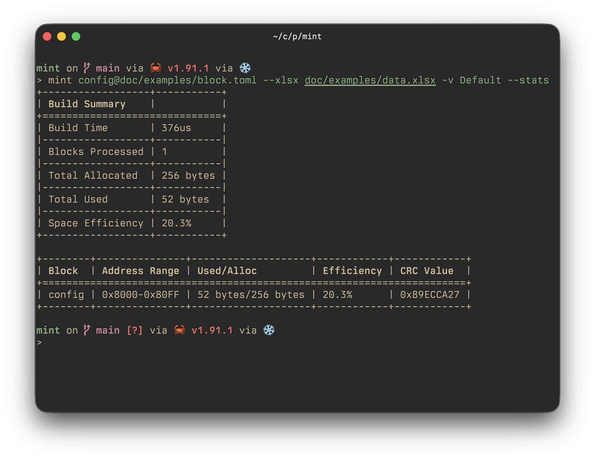

# mint

mint builds static binary flash blocks from TOML layout files and Excel or JSON data sources. It also generates matching C headers and ABI fingerprints from those layouts.

[Upgrading from v1](https://github.com/tomrford/mint/blob/main/doc/migration-v2.md)

mint is available as:

- `mint-core` - Rust library crate for layout parsing, data sources, bytestream assembly, output, C header rendering, ABI fingerprints, and in-memory build APIs.
- `mint-cli` - Implements the `mint` command-line tool for building flash blocks and generating C headers and ABI fingerprints.



### Install

```bash
cargo add mint-core
cargo install mint-cli
```

### Documentation

- [Layout files](https://github.com/tomrford/mint/blob/main/crates/mint-cli/doc/layout.md)
- [Data sources](https://github.com/tomrford/mint/blob/main/crates/mint-cli/doc/sources.md)
- [Command line](https://github.com/tomrford/mint/blob/main/crates/mint-cli/doc/cli.md)
- [Example layouts & data](https://github.com/tomrford/mint/tree/main/doc/examples)

The `mint` binary carries the same pages: `mint skill layout`, `mint skill sources` and `mint skill cli` print them, and `mint skill` prints a guide for coding agents.

### Quick Start

```bash
# Excel data source
mint build block.toml --xlsx data.xlsx --variants Default --stats

# JSON data source
mint build layout.toml -j data.json --variants Debug/Default

# Multiple blocks with options
mint build layout.toml#config layout.toml#data --xlsx data.xlsx --variants Default --stats

# Generate matching C typedefs and array/bitmap macros
mint header layout.toml -o layout.h

# Print every block's ABI fingerprint
mint fingerprint layout.toml

# Discover supported layout ABIs
mint abi list
```

### Layout Example

```toml
[mint]
abi = "generic-le"

[config.header]
start_address = 0x8000
length = 0x100

[config.data]
schema = { fingerprint = true, type = "u64" }
device.id = { value = 0x1234, type = "u32" }
device.name = { name = "DeviceName", type = "u8", size = 16 }
version = { name = "Version", type = "u16" }
gain = { value = 1.5, type = "uq8.8" }
coefficients = { name = "Coefficients", type = "f32", size = 4 }
matrix = { name = "Matrix", type = "i16", size = [2, 2] }

[data.header]
start_address = 0x8100
length = 0x100

[data.data]
counter = { name = "Counter", type = "u64" }
message = { value = "Hello", type = "u8", size = 16 }
```

See [`doc/examples/block.toml`](https://github.com/tomrford/mint/blob/main/doc/examples/block.toml) and its [generated header](https://github.com/tomrford/mint/blob/main/doc/examples/blocks.h) for a complete example.
